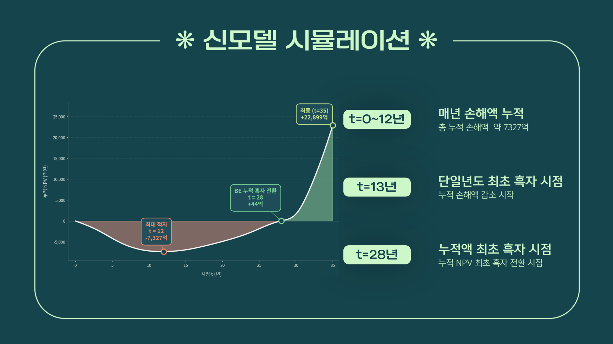

# 제조업 탄소전환 보험모델 프로젝트

**2026년 1학기 DArt-B 학술제 · 제조업 탄소전환을 위한 친환경 보험모델 제안**

고탄소 제조기업을 일괄 배제하는 대신, **탄소집약도와 감축 노력에 따라 보험료를 조정하면 제조기업의 전환 유인과 보험사의 장기 수익성을 함께 개선할 수 있을까?** 이 질문을 KOSPI 100에서 선정한 47개 제조기업의 가상 화재보험 포트폴리오로 분석한 팀 프로젝트입니다.

팀원: 문성환 · 윤재원 · 이혜준 · 전해인 · 정다나

[최종 발표 PDF](presentation/final_presentation.pdf) · [분석 방법](docs/methodology.md) · [파일·실행 안내](docs/reproduction.md) · [결과 검증](docs/validation.md) · [분석 이력](docs/timeline.md)

## 프로젝트 개요

| 항목 | 내용 |
|---|---|
| 분석 대상 | KOSPI 100 → 58개 후보 → 최종 47개 제조기업 |
| 포트폴리오 | 유형자산·재고자산을 담보액의 대리변수로 사용하는 가상 기업성 화재보험 |
| 자료 | DART 재무정보, ESG 공시 Scope 1+2 배출량, 사업장 위치·면적, WRI Aqueduct 위험점수, 산업별 보험 통계 |
| 방법 | 산업별 요율 매핑, 할인·할증, 위험 면적가중 집계, S-curve 탄소감축, 사건연구, 장기 손익·NPV |
| 구현 | Excel 수식 모형, Python/Jupyter, pandas·NumPy·statsmodels |

실제 보험계약·사고 데이터로 추정한 상품 요율이 아니라, 공개자료와 시나리오 가정을 결합한 학술 모형입니다. 아래 결과는 실제 성과가 아닌 **발표 당시의 시뮬레이션 결과**입니다.

## 분석 흐름


1. **담보액 구성:** 유형자산에서 토지·건설중인자산을 차감하고 재고자산을 더했습니다.
2. **위험과 노력 구분:** 상대 탄소집약도 `ρ`, 배출집약도 개선율 기반 전환노력 `M`, 사업장 물리적 위험 `PRF`를 연결했습니다.
3. **손익 계산:** `DF`로 보험료를 조정하고 발생손해액·사업비를 차감했습니다. `BPF`를 통해 요구자본과 투자 여력 변화도 계산했습니다.
4. **모형 수정:** 고탄소·고노력 기업에도 할증이 발생하는 문제를 확인하고 `α=0.10, β=1.00`에서 `α=0.05, β=0.80`으로 조정했습니다.
5. **장기 분석:** 산업별 기술 도입 속도, 기후위험 증가, 감축에 따른 손해율 변화, 보험사 가치평가 효과를 가정했습니다.
6. **도입 방안:** 초기 손실을 완화할 정부 지원과 기업별 전환성과 점수제를 제안했습니다.

## 발표에서 제시한 주요 결과

단위: 억 원. 페이지는 PDF의 실제 페이지 순서입니다.

| 지표 | 발표 결과 | 출처 |
|---|---:|---|
| 초기 구모델 보험영업손익 | +421.58 | p.16 |
| 초기 신모델 보험영업손익 | -570.61 | p.16, 가중치 조정 전 비교 |
| 초기 보험영업손익 차이 | -992.19 | p.16 |
| 신모델이 구모델보다 연간 유리해지는 시점 | t=13 | pp.37, 43 |
| 누적 NPV 최저점 | t=12, 약 -7,327 | p.37 |
| 누적 NPV 흑자 전환 | t=28 | p.37 |
| t=35 보험사 누적 NPV 이득 | +22,899 | p.43 |
| 제조기업 보험료 누적 절감 | 미할인 93,089 / 현재가치 51,512 | p.44 |

**해석:** 장기적인 전환 유인을 설계할 여지는 있지만, 초기 손실이 커서 보험사 단독 도입에는 부담이 있다는 결론입니다. `t=13`은 신구 모형의 **연간 차이**가 개선되는 시점이며, 신모델 영업손익 자체의 흑자 전환과 구분해야 합니다.



## 자료 구성

```text
models/          최종 회의의 통합 Excel 모형 원본
notebooks/       물리적 위험·탄소감축·사건연구 코드 원본 3개
 data/inputs/    코드 입력자료와 5/17 모형
 data/processed/ 당시 저장된 PRF 및 탄소감축 결과
presentation/    최종 발표 PDF와 주요 결과 슬라이드
results/         Excel 저장값을 추출한 기업별·연도별 CSV
 docs/           방법론·실행 안내·분석 이력·검증·출처
scripts/         원본 무결성 및 주요 계산 검증
```

**발표와 보관 파일은 완전히 동일한 버전이 아닙니다.** 통합 엑셀 저장값은 초기 신모델 영업손익 -456.80, t=35 누적 NPV +25,646.20으로 발표값과 다릅니다. 또한 t=31 이후 계산식 전환이 장기 결과에 영향을 줍니다. [검증 문서](docs/validation.md)에 셀 위치와 재현 한계를 기록했습니다. 발표값에 맞추기 위해 원본 가정이나 수식을 소급 수정하지 않았습니다.

## 확인 방법

```bash
python -m pip install -r requirements.txt
python scripts/verify_archive.py
```

파일 무결성과 주요 계산을 확인합니다. 전체 Excel 재계산이나 시장 데이터 재수집은 수행하지 않습니다. 노트북별 실행 환경과 입력 경로는 [재현 안내](docs/reproduction.md)에 있습니다.

